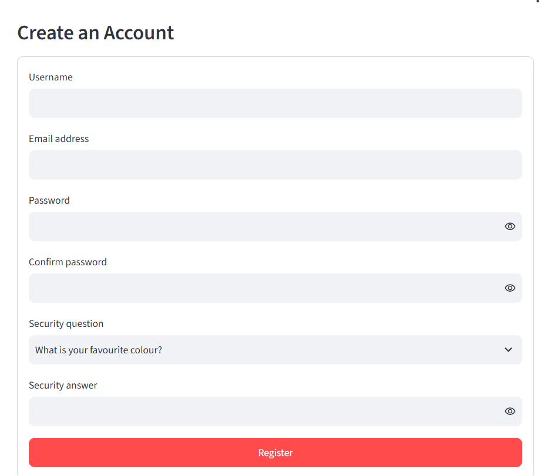
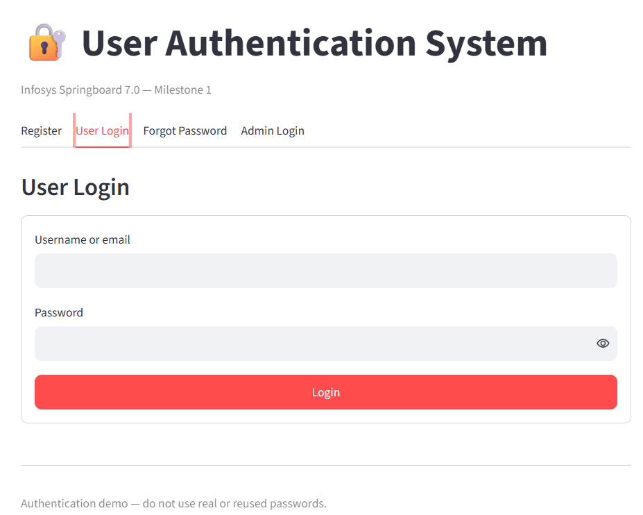
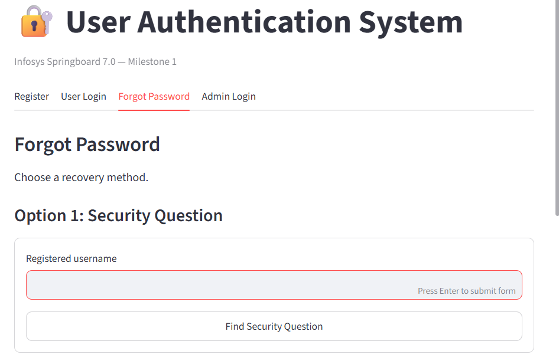
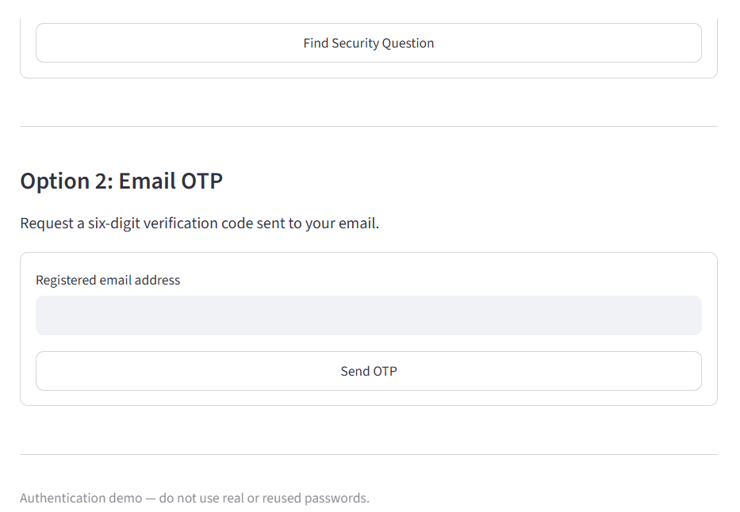
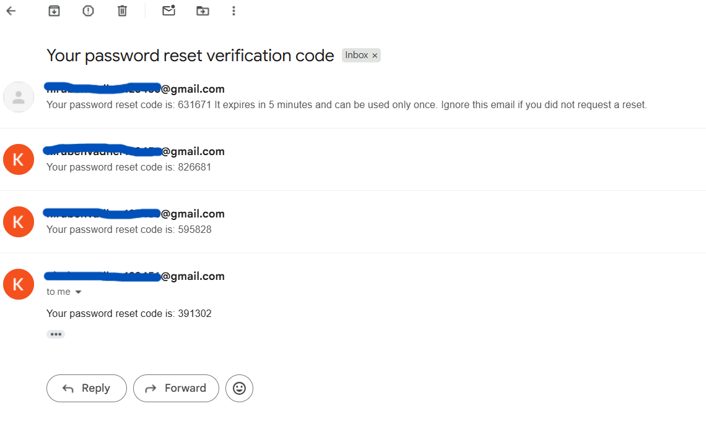
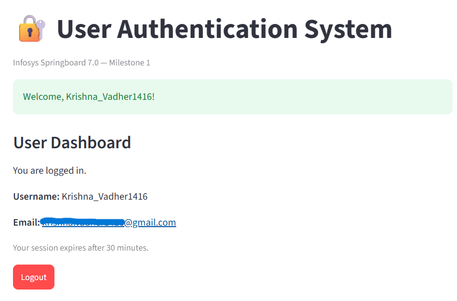
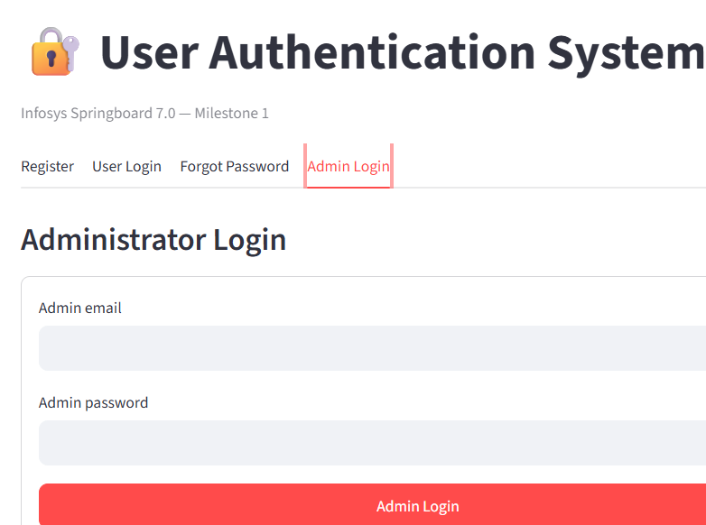
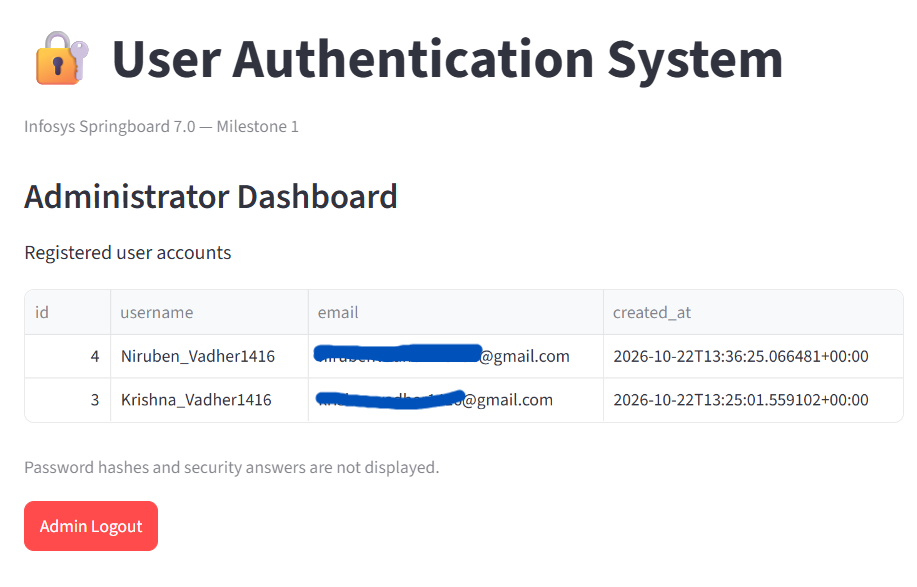

# Infosys Springboard Internship 7.0 — Milestone 1
## User Authentication and Password Recovery System

### 1. Project Overview

This project is a secure user authentication web application developed using Python and Streamlit. It allows users to register, log in, recover forgotten passwords, and access a personalized dashboard. It also provides a separate admin login and dashboard for viewing registered users.

The application uses SQLite for database storage, bcrypt for password hashing, and JSON Web Tokens (JWT) for session authentication. Password recovery is supported through security-question verification and email OTP verification.

### 2. Features

- **User Registration:** Register with a unique username, email, password, password confirmation, security question, and security answer.
- **Input Validation:** Validate email format, required fields, password strength, and password confirmation.
- **Secure Password Storage:** Hash passwords and security answers using bcrypt before storing them in the database.
- **User Login:** Log in using either a username or email address and a password.
- **JWT Authentication:** Generate and validate JWTs for authenticated sessions.
- **Password Recovery — Security Question:** Verify the registered security answer and set a new password.
- **Password Recovery — Email OTP:** Send a one-time password to the registered email address and verify it before resetting the password.
- **OTP Security:** Apply OTP expiry, verification-attempt limits, and request throttling.
- **Token Invalidation:** Invalidate existing sessions after a successful password reset.
- **User Dashboard:** Display the logged-in user's username and email, with a logout option.
- **Admin Dashboard:** Provide a separate admin login and display registered usernames and email addresses without exposing passwords.
- **Interactive Interface:** Provide registration, login, password recovery, and dashboard functionality through Streamlit.

### 3. Technology Stack

| Technology | Purpose |
|---|---|
| Python | Application logic |
| Streamlit | Web application interface |
| SQLite | User and OTP data storage |
| bcrypt | Password and security-answer hashing |
| PyJWT | JWT creation and verification |
| SMTP / Gmail | Email OTP delivery |
| Google Colab | Development and execution environment |
| ngrok | Temporary public access to the local Streamlit application |

### 4. Project Structure

```text
Milestone1/
├── Milestone1_Final.ipynb
├── README.md
└── screenshots/
    ├── login.png
    ├── signup.png
    ├── forgot_password_security_question.png
    ├── forgot_password_otp.png
    ├── otp_email.png
    ├── user_dashboard.png
    |── admin_dashboard.png
    |__ admin_login.png
```


### 5. Prerequisites

Before running the project, ensure you have:

- A Google account to access Google Colab.
- A Gmail account with an App Password configured for SMTP email delivery.
- An ngrok account and authentication token.
- The required Python packages, which can be installed or imported through the notebook.

### 6. Configuration and Secrets

The notebook uses Google Colab Secrets to manage sensitive configuration values.

Configure the following secrets in the Colab Secrets panel:

| Secret Name | Purpose |
|---|---|
| `JWT_SECRET` | Secret key used to sign JWTs |
| `NGROK_AUTHTOKEN` | Authentication token for ngrok |
| `EMAIL_ADDRESS` | Gmail address used to send OTP emails |
| `EMAIL_PASSWORD` | Gmail App Password |
| `ADMIN_EMAIL` | Configured administrator email, if required by the application |
| `ADMIN_PASSWORD` | Configured administrator password |

Enable notebook access to the configured secrets. Never publish actual secret values, Gmail App Passwords, JWT secrets, admin credentials, or ngrok tokens in this repository.

### 7. How to Run the Project

1. Open `Milestone1_Final.ipynb` in Google Colab.
2. Configure the required secrets using the Colab Secrets panel.
3. Connect to the Colab runtime.
4. Run the notebook cells in order.
5. Allow the notebook to initialize the database and launch the Streamlit application.
6. Open the generated ngrok URL to access the application.
7. Test registration, login, password recovery, user dashboard, and admin dashboard functionality.

**Important:** The ngrok URL is temporary and may change when the tunnel is restarted. The application and database may also be temporary depending on the Colab runtime.

### 8. Application Workflow

#### User Registration
The user enters the required registration details. The application validates the inputs, checks username uniqueness, hashes the password and security answer, and stores the registration data in SQLite.

#### User Login
The user logs in with a username or email address and password. On successful authentication, the application issues a JWT and stores the authenticated session information in Streamlit session state.

#### Forgot Password
Users can recover access through either of the following methods:

1. **Security Question:** Enter the username, verify the saved security answer, and set a new password.
2. **Email OTP:** Request a one-time code at the registered email address, verify the code, and set a new password.

Password-reset validation includes password-policy checks, confirmation matching, OTP expiry, and verification-attempt limits where applicable.

#### User Dashboard
After successful login, the application displays the user's username and email. The user can log out to end the session.

#### Admin Dashboard
The administrator signs in through the separate admin login. The dashboard displays registered usernames and email addresses only; password hashes and other authentication secrets must not be displayed.

### 9. Security Measures

- Passwords are stored as bcrypt hashes rather than plaintext.
- Security answers are hashed before storage.
- Password strength and confirmation are validated.
- Login failures use a generic error message to avoid unnecessarily revealing account details.
- JWTs have an expiry time and are validated before protected dashboard access.
- Password resets invalidate previously issued tokens.
- Email OTPs have an expiry time and are subject to verification-attempt and request limits.
- Sensitive configuration is managed through Colab Secrets.
- The admin dashboard does not expose users' passwords or password hashes.


## 10. Application Screenshots

### 10.1 User Registration


### 10.2 User Login


### 10.3 Forgot Password — Security Question


### 10.4 Forgot Password — Email OTP


### 10.5 OTP Email Verification


### 10.6 User Dashboard


### 10.7 Admin Login


### 10.8 Admin Dashboard



### 11. Testing Checklist

- [ ] Register a new user with valid details.
- [ ] Verify that duplicate usernames are rejected.
- [ ] Verify required-field and email validation.
- [ ] Verify password-strength and confirmation validation.
- [ ] Log in using a username.
- [ ] Log in using an email address.
- [ ] Verify that an incorrect password is rejected.
- [ ] Reset a password using the security question.
- [ ] Reset a password using email OTP.
- [ ] Verify OTP expiry and invalid-attempt handling.
- [ ] Verify that a password reset invalidates the old session token.
- [ ] Verify that the user dashboard displays the correct account details.
- [ ] Verify logout behavior.
- [ ] Verify that the admin dashboard displays usernames and emails without password data.

### 12. Limitations

- The ngrok URL is temporary.
- The application is designed as an internship milestone project and is not a production deployment.
- Database persistence depends on the execution environment and where the SQLite database is stored.
- Email OTP delivery depends on valid Gmail SMTP configuration and network availability.

### 13. Internship Details

**Program:** Infosys Springboard Internship 7.0  
**Milestone:** Milestone 1  
**Project:** User Authentication and Password Recovery System  
**Development Environment:** Google Colab

---

*This project demonstrates user authentication, input validation, secure credential storage, JWT-based session handling, password recovery, and role-separated dashboards using Python.*
